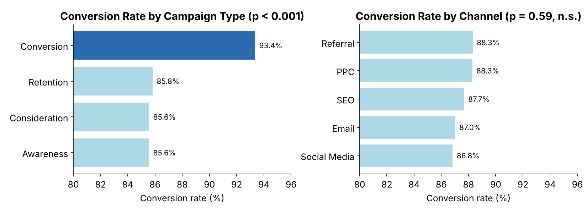
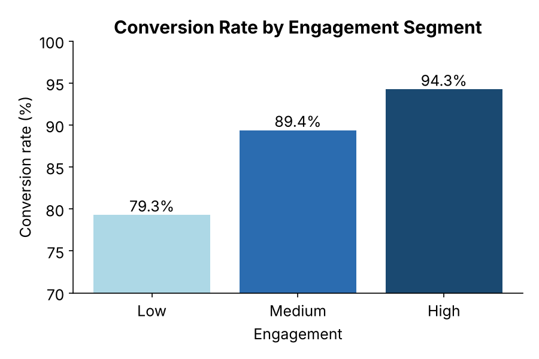
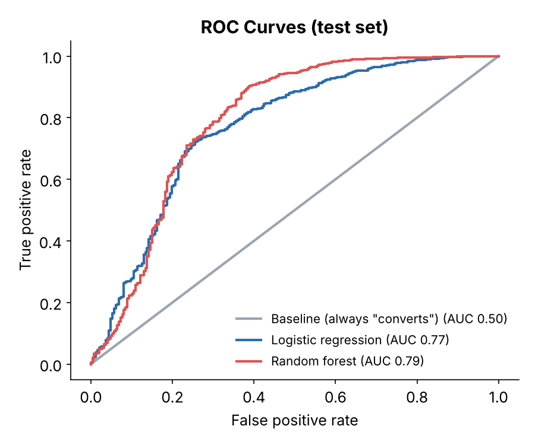

# Digital Marketing Campaigns: What Drives Conversion?

Statistical analysis and machine learning on 8,000 customers from digital marketing campaigns. It identifies which campaign and customer factors are associated with conversion, segments customers by engagement, and predicts who will **not** convert, with honest evaluation on imbalanced data.

**Tools:** Python (pandas, SciPy, scikit-learn), SQL (SQLite)
**Methods:** chi-square tests, Mann-Whitney U, effect sizes (Cohen's d), engagement segmentation, logistic regression, random forest, cross-validation

📓 [Notebook](notebooks/conversion_analysis.ipynb) · 🗄️ [SQL queries](sql/conversion_analysis.sql) · 🔗 [Kaggle version](https://www.kaggle.com/code/igormlopes/predict-conversion-digital-marketing)

---

## Business question
Which campaign types, channels and customer behaviours are associated with conversion? Can non-converters be flagged early so follow-up spend is targeted?

## Key results

| Finding | Evidence |
|---|---|
| **Campaign type matters** | "Conversion" campaigns convert **93.4%** vs about 86% for the other types (χ² p < 0.001) |
| **Channel doesn't** | 86.8%–88.3% across Email, PPC, Referral, SEO and Social. Not significant (p = 0.59) |
| **Behaviour beats demographics** | Time on site, email clicks/opens, ad spend and past purchases differ most (Cohen's d ≈ 0.3–0.4). Age and income don't differ |
| **Engagement segments** | Conversion rises from **79%** (low engagement) to **94%** (high) |
| **Prediction** | Random forest **ROC-AUC 0.79** (CV 0.82); catches 55% of non-converters vs 0% for the baseline |

<p align="center">
  
</p>
<p align="center">
  
  
</p>

### Why accuracy alone is misleading here
88% of customers convert, so a model that always predicts "converts" scores **88% accuracy** while catching **zero** non-converters. Models here are trained with balanced class weights and compared on ROC-AUC and on recall for non-converters:

| Model | Accuracy | Test AUC | Non-converters caught | Precision |
|---|---|---|---|---|
| Baseline (always "converts") | 87.6% | 0.50 | 0% | – |
| Logistic regression | 73.6% | 0.77 | 72% | 28% |
| Random forest | 88.3% | 0.79 | 55% | 53% |

`ConversionRate` is excluded from the features because it is itself a conversion outcome. Including it would make the model circular.

## Recommendations
1. **Prioritize conversion-focused campaign types.** They're about 8 points ahead of the others.
2. **Don't reallocate budget across channels** on these results. The differences are within random variation.
3. **Invest in engagement.** Email nurture and on-site content can lift low-engagement customers, who convert 15 points less.
4. **Score customers before a campaign closes** and send follow-up offers to likely non-converters.

## Data
[Predict Conversion in Digital Marketing](https://www.kaggle.com/datasets/rabieelkharoua/predict-conversion-in-digital-marketing-dataset) (Kaggle). It has 8,000 customers and 20 variables covering demographics, campaign, engagement and loyalty.
**Limitation:** the dataset is synthetic and has no timestamps, so results show the method and describe associations, not causes.

The data is **not included**. Download the CSV into `data/` to run the notebook.

## Repository structure
```
├── README.md
├── notebooks/conversion_analysis.ipynb
├── sql/conversion_analysis.sql
├── figures/
├── data/            # place the Kaggle CSV here (not tracked)
└── requirements.txt
```

---
**Igor M. Lopes**, CAPM® · MS Business Analytics & Project Management, University of Connecticut · [LinkedIn](https://linkedin.com/in/usbr-igorlopes) · [Kaggle](https://www.kaggle.com/igormlopes)
